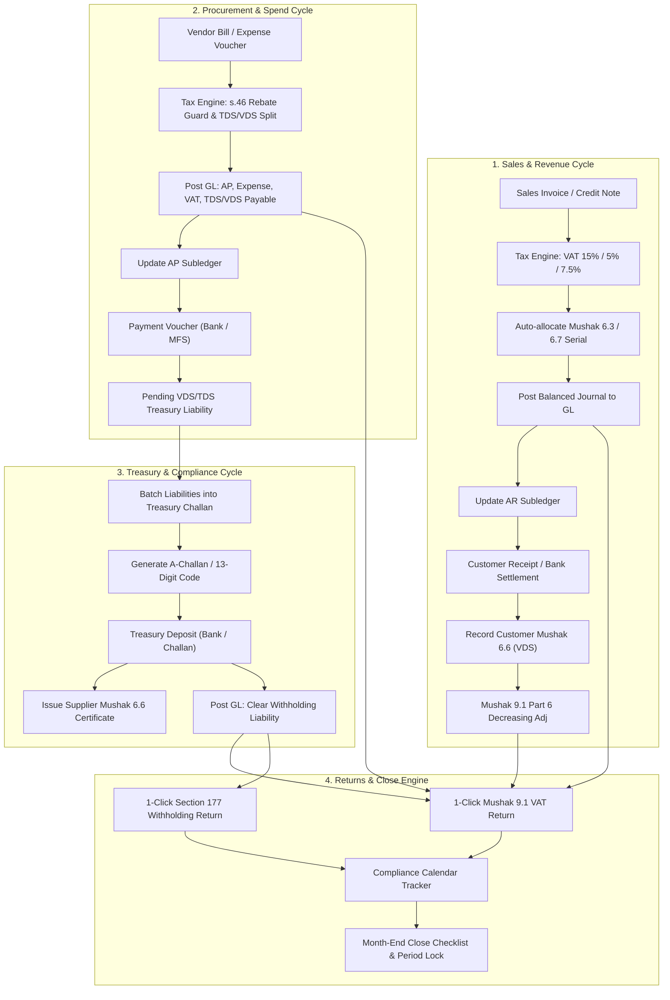
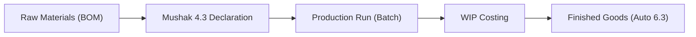
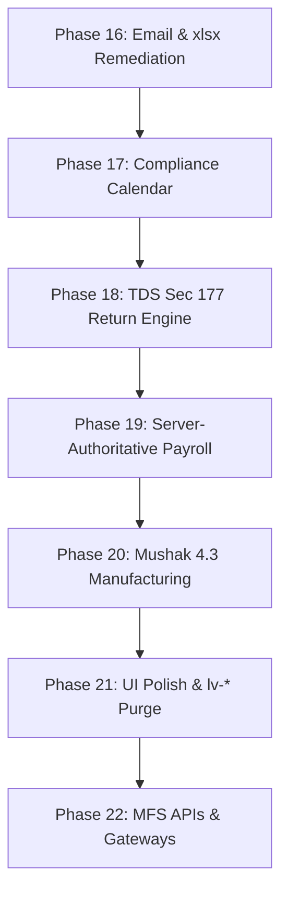

# Architectural Master Plan & Execution Blueprint: Fintuity Accounting Suite
**Document Classification:** Strategic Architecture & Regulatory Specification  
**Primary Target Consumer:** Upstream Architectural Reviewer (*Gemini 4 Argon*)  
**Execution Agent:** Autonomous Code Synthesizer (*DeepSeek*)  
**System Version Target:** Fintuity ERP v2.1.0 – Production Multi-Tenant Enterprise Engine  
**Jurisdiction:** People's Republic of Bangladesh (NBR, FRC, RJSC, BB, MoLE)

---

## Executive Architectural Summary for Argon

Argon, this document is your single source of truth for refining the roadmap, generating implementation specifications, and prompting the autonomous coding agent (DeepSeek). You will not have direct filesystem or shell access to the target codebase. Everything you need—exact database schemas, statutory logic, mathematical invariants, UI constraints, and regulatory nuances—is synthesized here.

### Current Codebase Baseline
The application is a TypeScript monorepo with:
- **Frontend (`src/`):** React 18, Vite 5, Tailwind CSS 3, Lucide React, Framer Motion. 
  - Dual-shell state: `ProductionShell.tsx` (server-backed pages) vs `DemoShell.tsx` (12 legacy mock workspaces).
  - Design tokens: Transitioning from legacy Lumen (`lv-*`) to Quiet Ledger (`ql-*`).
- **Backend (`server/`):** Node.js 22, Fastify 5, Drizzle ORM, PostgreSQL 16 (`pg` pool), `@node-rs/argon2`, Zod 4, Pino 10.
  - 62 relational tables with foreign keys and compound indexes.
  - Opaque sessions, HTTP-only cookies, CSRF validation, strict company-scoped multi-tenancy.
- **Core Domain (`src/core/`):** Pure TypeScript. Authoritative arithmetic uses `bigint` minor units (`poisha`, where $1\text{ BDT} = 100\text{ poisha}$, $10000000\text{n} = 1,00,000.00\text{ BDT}$). Rates use basis points ($1500\text{ bps} = 15.00\%$). Zero IEEE-754 floating-point operations in financial balances.

### Founder Core Vision & Defensible Moat
No existing accounting software in Bangladesh (neither foreign solutions like Tally, QuickBooks, and Xero, nor local desktop utilities) seamlessly unites:
1. **Automated Tax Deduction at Source (TDS) & Withholding VAT (VDS)** calculation at entry.
2. **One-click Treasury Challan generation** with official Bangladesh Bank 13-digit Economic Code mappings.
3. **Automated Mushak 6.6 Withholding Certificates** linked directly to Treasury Challan deposits.
4. **Automated Statutory Returns:** Mushak 9.1 Monthly VAT Return and Income Tax Act 2023 Section 177 Withholding Tax Return generated directly from posted journals.
5. **Built-in Bangladesh Compliance Calendar:** Proactive statutory countdowns (15th of month VAT/TDS, quarterly AIT, annual filings) with regulatory locking rules.
6. **Tier-Adaptive ERP Scalability:** From trading SMEs and IT export agencies to manufacturers requiring Mushak 4.3 Input-Output Coefficient Declarations and multi-client practice firms.

---

## 1. Statutory & Regulatory Specification (Authoritative Bangladesh Baseline)

### 1.1 Income Tax Act 2023 (Act No. 12 of 2023) — TDS & AIT Engine
The engine must implement the definitive rates under the Income Tax Act 2023 (ITA 2023), replacing the repealed 1984 Ordinance.

```
+----------------------------------------------------------------------------------------------------+
|                                    ITA 2023 TDS LOGIC MATRIX                                       |
+----------------------+-----------+-------------------------+---------------------------------------+
| Nature of Supply     | Statutory | Base Rate (Valid e-TIN) | Missing / Invalid e-TIN (+50% Penalty)|
|                      | Section   |                         | (Section 134 Upscale)                 |
+----------------------+-----------+-------------------------+---------------------------------------+
| Supply of Goods      | Sec 89    | 3.00% (300 bps)         | 4.50% (450 bps)                       |
| Professional/Tech    | Sec 90    | 10.00% (1000 bps)       | 15.00% (1500 bps)                     |
| Transport Services   | Sec 91    | 3.00% (300 bps)         | 4.50% (450 bps)                       |
| Media & Advertising  | Sec 92    | 4.00% - 5.00% (500 bps) | 7.50% (750 bps)                       |
| Commercial Rent      | Sec 109   | 5.00% (500 bps)         | 7.50% (750 bps)                       |
| Subcontract / Works  | Sec 88    | 5.00% - 7.00% (500 bps) | 7.50% - 10.50% (750 bps)              |
| Salaries / Payroll   | Sec 86    | Average Slab Rate       | Slab Rate + Surcharge                 |
+----------------------+-----------+-------------------------+---------------------------------------+
```

#### Key Statutory Invariants:
1. **Section 134 Upscale Invariant:** When `party.tin` is null, empty, or fails the 12-digit e-TIN validation algorithm (`/^\d{12}$/`), the system must automatically upscale the base TDS rate by $50\%$ ($1.50 \times \text{Base Rate}$).
2. **Quarterly Withholding Return (Section 177 / Rule 73/75):** All withholding entities must submit quarterly/half-yearly statements to the Deputy Commissioner of Taxes (DCT) showing:
   - Deductee name, address, 12-digit e-TIN, and BIN.
   - Nature of payment and statutory section.
   - Gross invoice amount, amount paid, TDS amount, Treasury Challan / e-Challan token, bank, branch, and deposit date.
   - *Requirement:* One-click export directly matching the prescribed NBR Section 177 tabular format.
3. **Advance Income Tax (AIT) Installments (Sections 154–156):** If the company's estimated total income exceeds BDT 6,00,000, AIT must be paid in four equal installments on or before:
   - 1st Installment: **15 September**
   - 2nd Installment: **15 December**
   - 3rd Installment: **15 March**
   - 4th Installment: **15 June**
   - *Requirement:* Auto-calculate required quarterly AIT based on annualized operating profit and past tax baselines.

---

### 1.2 VAT & Supplementary Duty Act 2012 & Ordinance No. 38 of 2026
The tax engine must strictly follow the Value Added Tax and Supplementary Duty Act 2012, incorporating the crucial amendment under **Ordinance No. 38 of 2026 (effective 13 October 2026)**.

#### 1. Ordinance No. 38 of 2026 — Section 64 Filing Cycle:
- The earlier proposal for quarterly VAT returns is officially superseded.
- **Rule:** Standard taxpayers must file **Mushak 9.1** within **15 days** after the close of the tax period (e.g., October return due by 15 November; if the 15th falls on a public holiday, the next business day).
- Government entities, semi-government, autonomous bodies, banks, insurers, and nil-return filers may file within **20 days**.

#### 2. VAT Rates & Input Tax Credit (Rebate) Guardrails (Section 46):
- Standard rate: $15\%$. Truncated rates: $5\%$ (trading/retail), $7.5\%$ (procurement providers). Zero-rate: $0\%$ (exports/deemed exports). Exempt supplies: First Schedule.
- **Section 46 Input Tax Rebate Invariant:** An input VAT rebate can *only* be credited to Account 1140 (`VAT Current Account`) if **all four** conditions are met:
  1. Vendor provides a valid 13-digit BIN (`/^\d{9}-\d{4}$/` or `/^\d{13}$/`).
  2. A valid **Mushak 6.3** Tax Invoice is attached with identical tax period dates.
  3. The bill is paid through banking channels (BEFTN, RTGS, Account Transfer, MFS) if the transaction amount exceeds **BDT 1,00,000** (Cash limit rule).
  4. The input VAT is at the standard $15\%$ rate. (Truncated rates $5\%$ and $7.5\%$ are strictly non-rebatable under Section 46(2) unless specifically notified by SRO; non-rebatable VAT must be capitalized into the expense or asset line).

#### 3. Withholding VAT (VDS - Section 49) & Mushak 6.6 Automation:
- When purchasing from procurement providers ($7.5\%$), advertising services ($15\%$), or rent ($15\%$), the buyer acts as a Withholding Entity.
- Net payment to vendor is:
  $$\text{Net Payable} = \text{Gross Amount} - \text{VDS Amount} - \text{TDS Amount}$$
- **Treasury Deposit & Mushak 6.6 Invariant:**
  - Withheld VDS must be deposited to the Government Treasury via A-Challan within **15 days** of the tax period.
  - The software must automatically generate **Mushak 6.6 (Withholding VAT Certificate)** in triplicate immediately upon linking the Treasury Challan deposit to the withheld liability.
  - For customer sales where the client withholds VDS: the receivable is cleared only upon recording the customer's Mushak 6.6 certificate, triggering an automated **Decreasing Adjustment in Mushak 9.1 Part 6 (Note 24)**.

#### 4. Mushak 9.1 Return Architecture:
The system must dynamically map the General Ledger and subledgers directly into the 12 parts and notes of Mushak 9.1:
- **Part 3:** Supplies subject to standard rate ($15\%$), truncated rates, zero-rate, and exemptions.
- **Part 4:** Purchases subject to standard rate (rebatable inputs), non-rebatable inputs, zero-rate, and imports (Bill of Entry).
- **Part 5:** Increasing Adjustments (late payment penalties, VDS deducted from suppliers not deposited).
- **Part 6:** Decreasing Adjustments (VDS deducted from company's sales by registered buyers via Mushak 6.6, advance tax paid at import).
- **Part 7 & 8:** Net VAT payable calculation and Treasury Challan adjustments.

#### 5. Manufacturing & Mushak 4.3 (Input-Output Coefficient):
- Under Rule 21 of VAT Rules 2016, every manufacturer or value-added supplier must declare input-output coefficients on **Mushak 4.3** at least 15 days before supplying goods.
- Must detail: Raw material consumption, wastage percentage (normal vs abnormal), packaging materials, utility/overhead allocations, and profit margin.

---

### 1.3 Official Bangladesh Government Treasury Economic Codes
Every Treasury Challan created in the software must map to the authoritative 13-digit Economic Code structure utilized by Bangladesh Bank, Sonali Bank, and the iVAS e-Challan / A-Challan system:

```
+------------------------------------------------------------------------------------+
|                      BANGLADESH GOVERNMENT TREASURY ECONOMIC CODES                 |
+----------------------------+-----------------------+-------------------------------+
| Tax / Statutory Obligation | Authority / Form      | 13-Digit Treasury Code        |
+----------------------------+-----------------------+-------------------------------+
| Value Added Tax (VAT)      | NBR - VAT Department  | 1/1141/0010/0311              |
| Supplementary Duty (SD)    | NBR - VAT Department  | 1/1141/0010/0711              |
| VAT Deduction Source (VDS) | NBR - Mushak 6.6      | 1/1141/0010/0311              |
| Turnover Tax               | NBR - Small Business  | 1/1141/0010/0301              |
| TDS on Contractors/Goods   | NBR - Income Tax s.89 | 1/1141/0010/0111              |
| TDS on Salaries / Payroll  | NBR - Income Tax s.86 | 1/1141/0010/0112              |
| TDS on House Property/Rent | NBR - Income Tax s.109| 1/1141/0010/0115              |
| TDS on Professional Fees   | NBR - Income Tax s.90 | 1/1141/0010/0116              |
| Advance Income Tax (AIT)   | NBR - Income Tax s.154| 1/1141/0010/0101              |
| Companies Act / RJSC Fees  | Ministry of Commerce  | 1/0741/0000/2101              |
+----------------------------+-----------------------+-------------------------------+
```

---

### 1.4 Bangladesh Labour (Amendment) Act 2026 & SRO 53-Law/2026
The server-side Payroll Engine must calculate exact compensation in minor units (`poisha`):
1. **Worker Classification:** Permanent, Probationary (maximum 6 months), Contractual, Piece-rate, Apprentice.
2. **Salary Structure:**
   $$\text{Gross Salary} = \text{Basic} + \text{House Rent Allowance (HRA)} + \text{Medical} + \text{Conveyance}$$
   *(Minimum Basic is legally pegged to $50\% - 60\%$ of gross based on industry wage boards).*
3. **Overtime (OT) Invariant (Section 108):**
   - Standard statutory monthly working hours = **208 hours** (based on a 48-hour regular work week).
   - Overtime rate is strictly **$2\times$ Basic Hourly Wage**:
     $$\text{Hourly Basic} = \frac{\text{Basic Salary}}{208}, \quad \text{OT Amount} = \text{OT Hours} \times (\text{Hourly Basic} \times 2)$$
4. **Festival Bonus:** Minimum 2 festival bonuses annually for permanent workers, each typically equal to $1\text{ Basic Salary}$ ($100\%$) or prorated for probationary employees.
5. **Provident Fund (PF):** Minimum $10\%$ employee contribution matched by $10\%$ employer contribution for recognized PFs under Section 264.
6. **Workers' Profit Participation Fund (WPPF):** $5\%$ of net profit before tax allocated to WPPF (Participation Fund $80\%$, Welfare Fund $10\%$, Central Welfare Fund $10\%$) under Chapter XV.

---

## 2. Core Functional Requirements & Workflow Specifications



---

### 2.1 Complete Withholding Tax & VAT Workflow (The Core Differentiator)

#### Step 1: Procurement Entry & Automatic Split
When an Accountant or Cashier enters a supplier bill (e.g., Office Rent of BDT 1,00,000 + 15% VAT):
1. **Rule Pack Trigger:** Vendor is checked for 12-digit e-TIN and 13-digit BIN.
2. **Tax Splits Calculated:**
   - Base Rent = BDT 1,00,000 ($10000000\text{ poisha}$)
   - VAT @ 15% = BDT 15,000 ($1500000\text{ poisha}$)
   - VDS @ 15% withheld = BDT 15,000 ($1500000\text{ poisha}$)
   - TDS @ 5% (with e-TIN) = BDT 5,000 ($500000\text{ poisha}$)
   - Net Payable to Landlord = $\text{BDT 1,00,000} + \text{BDT 15,000} - \text{BDT 15,000} - \text{BDT 5,000} = \text{BDT 95,000}$
3. **Atomic Journal Entry (`POST_TO_GL`):**
   - **DR** Account 5110 (Rent Expense): BDT 1,00,000
   - **DR** Account 1140 (VAT Current Account / Input Tax): BDT 15,000
   - **CR** Account 2110 (Accounts Payable - Landlord): BDT 95,000
   - **CR** Account 2130 (VDS Payable): BDT 15,000
   - **CR** Account 2140 (TDS Payable): BDT 5,000
   *(Entry balances to 0 poisha: $\text{Debit } 11500000\text{n} == \text{Credit } 11500000\text{n}$)*

#### Step 2: Month-End Batch Treasury Challan Deposit
1. The Accountant navigates to `/app/treasury`. The screen surfaces all open lines in Accounts 2130 (VDS) and 2140 (TDS).
2. The user checks 10 bills and clicks **"Assemble Treasury Challan"**.
3. The system groups lines by statutory 13-digit Economic Code (e.g., Code `1/1141/0010/0311` for VDS, Code `1/1141/0010/0115` for Rent TDS).
4. System generates the printed **Bangladesh A-Challan form** / XML payload for Sonali Bank / e-Challan with prefilled depositor details, bank account, and exact amounts.
5. Upon bank payment confirmation, the Challan is marked `POSTED`:
   - **DR** Account 2130 (VDS Payable): BDT 15,000
   - **CR** Account 1110 (Bank Account): BDT 15,000
6. **Automatic Certificate Trigger:** The engine instantly transitions the status of the associated **Mushak 6.6 Certificate** to `ISSUED`, complete with a unique certificate serial (`6.6/2026-27/00001`), ready for digital PDF export and automated email to the landlord.

#### Step 3: Year-End TDS/VDS Reconciliation & One-Click Section 177 Return
1. Under `/app/reports`, the system offers the **Section 177 Withholding Tax Return Studio**.
2. Aggregates every supplier payment, withheld TDS, bank challan number, and e-TIN verification into the official NBR schedule.
3. Automatically identifies anomalies:
   - Vendor paid without e-TIN where 50% penalty was not deducted.
   - TDS deducted but challan deposit was delayed past statutory deposit window (7 days).
4. Generates:
   - Schedule A (Salaries Section 86)
   - Schedule B (Contracts & Supplies Section 89)
   - Schedule C (Rent Section 109)
   - Schedule D (Professional Services Section 90)
   - Master Consolidated Return ready for immediate physical or e-filing submission.

---

### 2.2 Built-in Bangladesh Statutory Compliance Calendar Engine
No existing software provides proactive compliance scheduling tailored to Bangladeshi law. The system must implement an intelligent, reactive calendar engine:

```
+------------------------------------------------------------------------------------------------+
|                         FINTUITY STATUTORY COMPLIANCE CALENDAR                                 |
+-------------------+----------------------+-------------------+---------------------------------+
| Due Date / Trigger| Statutory Obligation | Governing Act     | System Trigger & Workflow Action|
+-------------------+----------------------+-------------------+---------------------------------+
| 15th of Every     | Mushak 9.1 VAT Return| VAT & SD Act 2012 | Runs draft return; flags open   |
| Month             | & VDS Treasury Dep.  | Ord. 38 of 2026   | challans; locks past tax period |
+-------------------+----------------------+-------------------+---------------------------------+
| 15th of Every     | Monthly TDS Statement| Income Tax Act    | Aggregates previous month's TDS |
| Month             | & Salary TDS Deposit | 2023, Section 177 | challans; reconciles to payroll |
+-------------------+----------------------+-------------------+---------------------------------+
| 15 Sep / 15 Dec / | Advance Income Tax   | Income Tax Act    | Estimates annualized PBT; checks|
| 15 Mar / 15 Jun   | (AIT) Installments   | 2023, Section 154 | cash runway; drafts AIT challan |
+-------------------+----------------------+-------------------+---------------------------------+
| 30 November       | Annual Corporate Tax | Income Tax Act    | Audited IFRS P&L bridge; capital|
| (Tax Day)         | Return (s.166)       | 2023, Section 166 | allowances; tax deprec. schedule|
+-------------------+----------------------+-------------------+---------------------------------+
| Within 30 days of | RJSC Annual Return   | Companies Act     | Generates Form XII (Directors), |
| Annual General Mtg| Filing (Form IX/XII) | 1994, Section 36  | Form X, Balance Sheet extract   |
+-------------------+----------------------+-------------------+---------------------------------+
| 30 April /        | Half-Yearly TDS      | Income Tax Act    | Assembles half-yearly deductee  |
| 31 October        | Return (s.177)       | 2023, Rule 73     | register with challan proofs    |
+-------------------+----------------------+-------------------+---------------------------------+
```

#### Calendar Engine Features:
- **Bangladesh Government Holiday Awareness:** Dynamic calendar module incorporating Eid-ul-Fitr, Eid-ul-Adha, Durga Puja, National Days, and executive holiday orders. When the 15th falls on a Friday, Saturday, or gazetted holiday, the statutory deadline smoothly advances to the next official working day.
- **Visual Alert Rings:** Dashboard header renders interactive countdown chips (e.g., `VAT 9.1: 6 Days Remaining`, `AIT Q2: 22 Days`).
- **Automated Period Locking:** Option for automatic hardening of closed periods at midnight on the 15th, blocking backdated postings without Controller override.

---

### 2.3 Manufacturing & Mushak 4.3 Input-Output Engine



For manufacturing enterprises (RMG, light engineering, food processing, chemicals):
1. **Multi-Level Bill of Materials (BOM):** Link finished products to raw material SKU lines with defined standard usage coefficients (e.g., $1.2\text{ kg}$ yarn per shirt, including $0.2\text{ kg}$ normal cutting wastage).
2. **Mushak 4.3 Declaration Generator:**
   - Automatically computes total raw material cost (FIFO or Moving Average).
   - Adds packaging, direct labor, utility allocation, and profit margin.
   - Generates the official NBR Mushak 4.3 form in Bengali and English.
   - Records NBR submission date, divisional officer approval reference, and effective date.
3. **Automated Cost of Goods Sold (COGS) Journal:**
   Posting a production batch automatically debits Finished Goods (Account 1320), credits Raw Materials (Account 1310), and credits Direct Labor Absorbed (Account 5210).

---

### 2.4 Multi-Client Accounting Practice Firm Cockpit
For Chartered Accountants (CA) and tax consultancy firms managing 50+ clients:
1. **Tenant Switcher Console:** A dedicated multi-tenant practice view where partners and senior auditors see all client entities in a single high-density grid.
2. **Statutory Health Indicators:** Displays real-time filing status across all clients:
   - Client A: VAT 9.1 Draft Ready (BDT 2,45,000 payable)
   - Client B: 3 Unmatched Bank Lines; Period Open
   - Client C: Missing 4 e-TINs on Subcontractor Bills
3. **Role-Restricted External Auditor Access:** Dedicated read-only role (`AUDITOR`) that grants instant access to subledger-to-GL reconciliations, trial balances, and the complete 9-Tab Audit Pack, without permitting any journal modifications.

---

## 3. Database Schema Extensions (PostgreSQL 16 & Drizzle ORM)

Argon, direct DeepSeek to add these schemas to `server/src/db/schema.ts` to support the expanded vision. All tables must maintain strict multi-tenancy (`companyId`), foreign keys with `{ onDelete: 'restrict' }`, and compound indexes.

```typescript
// ==============================================================================================
// 1. STATUTORY COMPLIANCE CALENDAR
// ==============================================================================================
export const complianceCalendarEvents = pgTable(
  'compliance_calendar_events',
  {
    id: uuid('id').primaryKey().defaultRandom(),
    companyId: uuid('company_id').notNull().references(() => companies.id, { onDelete: 'restrict' }),
    titleEn: text('title_en').notNull(),
    titleBn: text('title_bn').notNull(),
    statutoryBody: text('statutory_body').notNull(), // 'NBR_VAT' | 'NBR_TAX' | 'RJSC' | 'BSEC' | 'MOLE'
    category: text('category').notNull(), // 'VAT_91' | 'TDS_MONTHLY' | 'TDS_177' | 'AIT_QUARTERLY' | 'ANNUAL_TAX' | 'RJSC_ANNUAL'
    statutoryDeadline: date('statutory_deadline').notNull(),
    adjustedDeadline: date('adjusted_deadline').notNull(), // After weekend/holiday adjustment
    periodId: uuid('period_id').references(() => periods.id, { onDelete: 'restrict' }),
    status: text('status').notNull().default('PENDING'), // 'PENDING' | 'PREPARED' | 'FILED' | 'OVERDUE'
    assignedUserId: uuid('assigned_user_id').references(() => users.id, { onDelete: 'set null' }),
    filedAt: timestamp('filed_at', { withTimezone: true, mode: 'date' }),
    filingReference: text('filing_reference'), // A-Challan token, NBR e-filing ACK number
    notes: text('notes'),
    createdAt: timestamp('created_at', { withTimezone: true, mode: 'date' }).notNull().defaultNow(),
    updatedAt: timestamp('updated_at', { withTimezone: true, mode: 'date' }).notNull().defaultNow(),
  },
  (table) => [
    index('compliance_cal_company_deadline_idx').on(table.companyId, table.adjustedDeadline),
    index('compliance_cal_company_status_idx').on(table.companyId, table.status),
  ]
);

// ==============================================================================================
// 2. WITHHOLDING TAX (TDS) SECTION 177 RETURN TABLES
// ==============================================================================================
export const withholdingTaxReturns = pgTable(
  'withholding_tax_returns',
  {
    id: uuid('id').primaryKey().defaultRandom(),
    companyId: uuid('company_id').notNull().references(() => companies.id, { onDelete: 'restrict' }),
    fiscalYearId: uuid('fiscal_year_id').notNull().references(() => fiscalYears.id, { onDelete: 'restrict' }),
    returnType: text('return_type').notNull(), // 'MONTHLY_STATEMENT' | 'HALF_YEARLY_177' | 'ANNUAL_177'
    periodStart: date('period_start').notNull(),
    periodEnd: date('period_end').notNull(),
    totalGrossPaidPoisha: bigint('total_gross_paid_poisha', { mode: 'bigint' }).notNull().default(0n),
    totalTdsDeductedPoisha: bigint('total_tds_deducted_poisha', { mode: 'bigint' }).notNull().default(0n),
    totalTdsDepositedPoisha: bigint('total_tds_deposited_poisha', { mode: 'bigint' }).notNull().default(0n),
    status: text('status').notNull().default('DRAFT'), // 'DRAFT' | 'VERIFIED' | 'SUBMITTED'
    submissionAckNumber: text('submission_ack_number'),
    submittedAt: timestamp('submitted_at', { withTimezone: true, mode: 'date' }),
    preparedBy: uuid('prepared_by').notNull().references(() => users.id, { onDelete: 'restrict' }),
    verifiedBy: uuid('verified_by').references(() => users.id, { onDelete: 'restrict' }),
    createdAt: timestamp('created_at', { withTimezone: true, mode: 'date' }).notNull().defaultNow(),
    updatedAt: timestamp('updated_at', { withTimezone: true, mode: 'date' }).notNull().defaultNow(),
  },
  (table) => [
    unique('withholding_returns_company_period_unique').on(table.companyId, table.returnType, table.periodStart, table.periodEnd),
  ]
);

export const withholdingReturnLines = pgTable(
  'withholding_return_lines',
  {
    id: uuid('id').primaryKey().defaultRandom(),
    companyId: uuid('company_id').notNull().references(() => companies.id, { onDelete: 'restrict' }),
    returnId: uuid('return_id').notNull().references(() => withholdingTaxReturns.id, { onDelete: 'cascade' }),
    partyId: uuid('party_id').references(() => parties.id, { onDelete: 'restrict' }),
    deducteeName: text('deductee_name').notNull(),
    deducteeTin: text('deductee_tin'), // 12-digit e-TIN
    deducteeBin: text('deductee_bin'), // 13-digit BIN
    deducteeAddress: text('deductee_address'),
    sectionCode: text('section_code').notNull(), // 'SEC_89_GOODS' | 'SEC_90_SERVICE' | 'SEC_109_RENT' etc.
    grossAmountPoisha: bigint('gross_amount_poisha', { mode: 'bigint' }).notNull(),
    tdsRateBps: integer('tds_rate_bps').notNull(),
    tdsAmountPoisha: bigint('tds_amount_poisha', { mode: 'bigint' }).notNull(),
    paymentDate: date('payment_date').notNull(),
    challanId: uuid('challan_id').references(() => treasuryChallans.id, { onDelete: 'set null' }),
    challanNumber: text('challan_number'),
    challanDate: date('challan_date'),
    bankCode: text('bank_code'),
    economicCode: text('economic_code').notNull(), // 13-digit code
  },
  (table) => [
    index('withholding_lines_return_idx').on(table.companyId, table.returnId),
  ]
);

// ==============================================================================================
// 3. MANUFACTURING & MUSHAK 4.3 ENGINE
// ==============================================================================================
export const mushak43Declarations = pgTable(
  'mushak_43_declarations',
  {
    id: uuid('id').primaryKey().defaultRandom(),
    companyId: uuid('company_id').notNull().references(() => companies.id, { onDelete: 'restrict' }),
    declarationNumber: text('declaration_number').notNull(), // 'M43-2026-0001'
    finishedItemId: uuid('finished_item_id').notNull().references(() => items.id, { onDelete: 'restrict' }),
    outputQuantity: numeric('output_quantity', { precision: 16, scale: 4 }).notNull(),
    outputUnit: text('output_unit').notNull(),
    effectiveFrom: date('effective_from').notNull(),
    effectiveTo: date('effective_to'),
    status: text('status').notNull().default('DRAFT'), // 'DRAFT' | 'SUBMITTED_TO_NBR' | 'APPROVED' | 'SUPERSEDED'
    nbrSubmissionDate: date('nbr_submission_date'),
    nbrDivisionOffice: text('nbr_division_office'),
    totalRawMaterialCostPoisha: bigint('total_rm_cost_poisha', { mode: 'bigint' }).notNull().default(0n),
    directLaborCostPoisha: bigint('direct_labor_cost_poisha', { mode: 'bigint' }).notNull().default(0n),
    manufacturingOverheadPoisha: bigint('overhead_cost_poisha', { mode: 'bigint' }).notNull().default(0n),
    packagingCostPoisha: bigint('packaging_cost_poisha', { mode: 'bigint' }).notNull().default(0n),
    targetProfitMarginBps: integer('target_profit_margin_bps').notNull().default(1500), // 15%
    declaredRetailPricePoisha: bigint('declared_price_poisha', { mode: 'bigint' }).notNull(),
    createdAt: timestamp('created_at', { withTimezone: true, mode: 'date' }).notNull().defaultNow(),
    updatedAt: timestamp('updated_at', { withTimezone: true, mode: 'date' }).notNull().defaultNow(),
  },
  (table) => [
    unique('mushak_43_company_number_unique').on(table.companyId, table.declarationNumber),
    index('mushak_43_item_idx').on(table.companyId, table.finishedItemId),
  ]
);

export const mushak43Ingredients = pgTable(
  'mushak_43_ingredients',
  {
    id: uuid('id').primaryKey().defaultRandom(),
    companyId: uuid('company_id').notNull().references(() => companies.id, { onDelete: 'restrict' }),
    declarationId: uuid('declaration_id').notNull().references(() => mushak43Declarations.id, { onDelete: 'cascade' }),
    rawItemId: uuid('raw_item_id').notNull().references(() => items.id, { onDelete: 'restrict' }),
    grossQuantity: numeric('gross_quantity', { precision: 16, scale: 4 }).notNull(),
    wastagePercentageBps: integer('wastage_bps').notNull().default(0), // e.g. 500 = 5%
    netQuantity: numeric('net_quantity', { precision: 16, scale: 4 }).notNull(),
    unit: text('unit').notNull(),
    ratePerUnitPoisha: bigint('rate_per_unit_poisha', { mode: 'bigint' }).notNull(),
    totalCostPoisha: bigint('total_cost_poisha', { mode: 'bigint' }).notNull(),
    rebatableInputVat: boolean('rebatable_input_vat').notNull().default(true),
  },
  (table) => [
    index('mushak_43_ingredients_declaration_idx').on(table.companyId, table.declarationId),
  ]
);

// ==============================================================================================
// 4. SERVER-BACKED BANGLADESH LABOUR ACT PAYROLL TABLES
// ==============================================================================================
export const payrollEmployees = pgTable(
  'payroll_employees',
  {
    id: uuid('id').primaryKey().defaultRandom(),
    companyId: uuid('company_id').notNull().references(() => companies.id, { onDelete: 'restrict' }),
    employeeCode: text('employee_code').notNull(),
    nameEn: text('name_en').notNull(),
    nameBn: text('name_bn'),
    workerClassification: text('worker_classification').notNull(), // 'PERMANENT' | 'PROBATIONARY' | 'CONTRACTUAL' | 'PIECE_RATE' | 'APPRENTICE'
    nidNumber: text('nid_number'),
    etin: text('etin'),
    joiningDate: date('joining_date').notNull(),
    basicSalaryPoisha: bigint('basic_salary_poisha', { mode: 'bigint' }).notNull(),
    houseRentAllowancePoisha: bigint('hra_poisha', { mode: 'bigint' }).notNull(),
    medicalAllowancePoisha: bigint('medical_poisha', { mode: 'bigint' }).notNull(),
    conveyanceAllowancePoisha: bigint('conveyance_poisha', { mode: 'bigint' }).notNull(),
    providentFundEnrolled: boolean('pf_enrolled').notNull().default(true),
    paymentChannel: text('payment_channel').notNull().default('BANK'), // 'BANK' | 'BKASH' | 'NAGAD' | 'CASH'
    bankAccountNumber: text('bank_account_number'),
    bankRoutingNumber: text('bank_routing_number'),
    mfsNumber: text('mfs_number'),
    status: text('status').notNull().default('ACTIVE'),
    createdAt: timestamp('created_at', { withTimezone: true, mode: 'date' }).notNull().defaultNow(),
  },
  (table) => [
    unique('payroll_employees_code_unique').on(table.companyId, table.employeeCode),
  ]
);

export const payrollRuns = pgTable(
  'payroll_runs',
  {
    id: uuid('id').primaryKey().defaultRandom(),
    companyId: uuid('company_id').notNull().references(() => companies.id, { onDelete: 'restrict' }),
    periodId: uuid('period_id').notNull().references(() => periods.id, { onDelete: 'restrict' }),
    batchDate: date('batch_date').notNull(),
    totalGrossPoisha: bigint('total_gross_poisha', { mode: 'bigint' }).notNull().default(0n),
    totalOtPoisha: bigint('total_ot_poisha', { mode: 'bigint' }).notNull().default(0n),
    totalBonusPoisha: bigint('total_bonus_poisha', { mode: 'bigint' }).notNull().default(0n),
    totalTdsPoisha: bigint('total_tds_poisha', { mode: 'bigint' }).notNull().default(0n),
    totalPfEmployeePoisha: bigint('total_pf_employee_poisha', { mode: 'bigint' }).notNull().default(0n),
    totalPfEmployerPoisha: bigint('total_pf_employer_poisha', { mode: 'bigint' }).notNull().default(0n),
    netPayablePoisha: bigint('net_payable_poisha', { mode: 'bigint' }).notNull().default(0n),
    journalId: uuid('journal_id').references(() => journals.id, { onDelete: 'restrict' }),
    status: text('status').notNull().default('DRAFT'), // 'DRAFT' | 'APPROVED' | 'POSTED' | 'DISBURSED'
    approvedBy: uuid('approved_by').references(() => users.id, { onDelete: 'restrict' }),
    createdAt: timestamp('created_at', { withTimezone: true, mode: 'date' }).notNull().defaultNow(),
  },
  (table) => [
    unique('payroll_runs_period_unique').on(table.companyId, table.periodId),
  ]
);
```

---

## 4. External Integrations & API Architecture

```
                                +-----------------------------+
                                |  Fintuity API / Server Hub  |
                                +--------------+--------------+
                                               |
             +--------------------+------------+------------+--------------------+
             |                    |                         |                    |
             v                    v                         v                    v
     +---------------+    +---------------+         +---------------+    +---------------+
     |  bKash Direct |    |  Nagad Direct |         |   SSLCommerz  |    |  BEFTN / NPSB |
     |  PGW Webhook  |    |  API Webhook  |         |   AamarPay    |    |  Bulk Upload  |
     +---------------+    +---------------+         +---------------+    +---------------+
             |                    |                         |                    |
             v                    v                         v                    v
      [Auto-Fee Split]     [Auto-Fee Split]          [MDR Fee Deduct]     [Salary Payout]
      [GL: Charge 5190]    [GL: Charge 5190]         [GL: Charge 5190]    [Bank 1110 Out]
```

### 4.1 Bangladesh Banking & MFS Gateway Connectivity
To bridge the manual divide:
1. **bKash & Nagad Merchant Webhook Endpoints:**
   - Real-time notification receiver for customer payments.
   - Automatically posts customer payment receipts and calculates the precise **bKash Merchant Cash-Out / Payment Fee ($1.20\% - 1.50\%$)**:
     - **DR** Account 1120 (bKash Merchant Wallet): Net Cash Received
     - **DR** Account 5190 (Payment Gateway & MFS Fees): BDT Fee
     - **CR** Account 1210 (Accounts Receivable): Gross Invoice Amount
2. **BEFTN / RTGS Bulk Payout Generator:**
   - Generates the standard 128-column fixed-width text or CSV file specified by Bangladesh Bank for Electronic Fund Transfers.
   - Allows one-click batch upload to Eastern Bank (EBL Connect), City Bank (Citylive), Standard Chartered (Straight2Bank), or BRAC Bank (CorpNet).
3. **Payment Gateway Settlement Reconciler (SSLCommerz / AamarPay):**
   - Automatically imports settlement batch files.
   - Separates Gross Customer Collections from Gateway Merchant Discount Rate (MDR) deductions and withholding tax.

### 4.2 Excel & Reporting Engine Modernization
**Critical Vulnerability Fix:** Eliminate `xlsx@0.18.5` (CVEs: GHSA-4r6h-8v6p-xvw6, GHSA-5pgg-2g8v-p4x9).
- **Replacement Strategy:**
  1. Migrate fully to **`exceljs`** (or a lean, audited streaming XML workbook builder).
  2. Implement an automated **9-Tab Audit Pack Exporter**:
     - Tab 1: System Metadata, Integrity Hash & Audit Chain Verification
     - Tab 2: Full Year General Ledger (all posted lines)
     - Tab 3: Monthly Comparative Trial Balance
     - Tab 4: IAS 1 Balance Sheet with Notes
     - Tab 5: IFRS 18 Statement of Profit or Loss
     - Tab 6: IAS 7 Direct & Indirect Cash Flows
     - Tab 7: Subledger Reconciliations (AR, AP, Inventory)
     - Tab 8: Mushak 9.1 VAT & 6.6 VDS Reconciliation Register
     - Tab 9: Income Tax Section 177 Deductee TDS Schedule

---

## 5. Phased Implementation Roadmap & Instructions for Argon

Argon, use the following phased blueprint when structuring prompts for DeepSeek. Do not attempt all phases at once; maintain strict sequential verification gates.



---

### Phase 16: Immediate Release Blockers & Security Remediation
- **Goal:** Unblock the release gate by removing open vulnerabilities and mock email stubs.
- **Tasks:**
  1. Replace `xlsx@0.18.5` with `exceljs` across `src/core/import-export/` and server exporters. Ensure zero bundle size inflation in entry chunk.
  2. Implement real transactional email transport in `server/src/auth/email.ts` supporting standard SMTP (Nodemailer) and API webhooks (SendGrid / AWS SES), governed by `SMTP_HOST`, `SMTP_PORT`, `SMTP_USER`, `SMTP_PASS` in `.env`.
  3. Keep the file outbox only when `NODE_ENV === 'test'`.
- **Verification Gate:** `npm audit --omit=dev` exits 0. Automated password reset email delivers over local SMTP test harness.

---

### Phase 17: Bangladesh Statutory Compliance Calendar Engine
- **Goal:** Implement the proactive calendar and filing tracker.
- **Tasks:**
  1. Run PostgreSQL migration for `compliance_calendar_events`.
  2. Implement `server/src/compliance/calendarService.ts` containing the Bangladesh gazetted holiday calculation and Section 64/177 rules.
  3. Build `src/pages/compliance/ComplianceCalendarPage.tsx` with monthly grid, countdown badges, and one-click "Prepare Return" hooks.
  4. Mount Compliance in `src/shell/navigation.ts` under group `CONTROL`.
- **Verification Gate:** Integration test verifies that if the 15th falls on a Friday, the adjusted deadline moves to Sunday (17th).

---

### Phase 18: Section 177 Withholding Tax Return & VDS Reconciliation Studio
- **Goal:** The founder's core dream—1-click withholding tax and VAT returns.
- **Tasks:**
  1. Run PostgreSQL migration for `withholding_tax_returns` and `withholding_return_lines`.
  2. Implement `server/src/reports/withholdingService.ts` to aggregate all bills with Section 89, 90, 91, 92, and 109 TDS deductions.
  3. Build the UI in `src/pages/reports/WithholdingReturnPage.tsx` with dynamic e-TIN check, challan link verification, and Excel download matching the NBR Section 177 tabular format.
  4. Connect Treasury Challan deposits to automatically trigger Mushak 6.6 certificate status updates.
- **Verification Gate:** Self-check vector proves that 25 purchase bills with TDS properly generate Schedules A, B, C, and D without mathematical variance.

---

### Phase 19: Server-Authoritative Labour Act Payroll Migration
- **Goal:** Elevate W10 from demo status to a production, multi-tenant payroll engine.
- **Tasks:**
  1. Run PostgreSQL migration for `payroll_employees`, `payroll_runs`.
  2. Implement `server/src/payroll/payrollService.ts` enforcing 208-hour overtime math, festival bonus logic, and 10% PF.
  3. Build `src/pages/payroll/PayrollPage.tsx` (replacing demo `W10`).
  4. Posting payroll creates an atomic GL journal:
     - **DR** Salary Expense, **DR** Overtime Expense, **DR** Employer PF Expense.
     - **CR** Employee PF Payable, **CR** Salary TDS Payable (Account 2140), **CR** Net Salaries Payable.
- **Verification Gate:** Integration test verifies balanced journal posting and BEFTN Excel file generation.

---

### Phase 20: Manufacturing BOM & Mushak 4.3 Engine
- **Goal:** Support value-added manufacturing and NBR coefficient declarations.
- **Tasks:**
  1. Run PostgreSQL migration for `mushak_43_declarations` and `mushak_43_ingredients`.
  2. Implement `server/src/inventory/mushak43Service.ts` with FIFO/Weighted Average raw material valuation.
  3. Build `src/pages/inventory/Mushak43Page.tsx` allowing engineers to compose BOMs and print the bilingual Mushak 4.3 form.
- **Verification Gate:** Production test proves batch completion accurately debits Finished Goods and credits Raw Materials + Overhead absorption.

---

### Phase 21: Quiet Ledger UI Unification & Legacy Token Purge
- **Goal:** Achieve visual elegance and design consistency across all pages.
- **Tasks:**
  1. Purge all 480 lingering `lv-*` CSS class names from `src/pages/` and `src/shell/`.
  2. Standardize on `.ql-card`, `.ql-table`, `.ql-btn`, `.ql-badge`.
  3. Unify brand assets: Replace all references to *LedgerVault* with **Fintuity Accounting Suite**.
  4. Ensure complete bilingual parity for deep panels (setup steps, banking workbench).
- **Verification Gate:** `grep -rn "lv-" src/pages/` returns zero hits. Lighthouse accessibility scores 1.00 on all authenticated routes.

---

### Phase 22: MFS Gateway Webhooks & Bank APIs
- **Goal:** Automate bank feed matching and customer collections.
- **Tasks:**
  1. Implement secure webhook endpoints for bKash and Nagad payment notifications with HMAC SHA-256 signature verification.
  2. Implement automatic MDR fee splitting into Account 5190.
  3. Add SSLCommerz batch settlement reconciliation.
- **Verification Gate:** Mock webhook call posts customer payment, deducts 1.5% fee to Account 5190, and marks invoice paid.

---

## 6. Exact Prompting Directives for DeepSeek (Via Argon)

When prompting DeepSeek for implementation, Argon must enforce the following non-negotiable coding rules:

```
+----------------------------------------------------------------------------------------------------+
|                               NON-NEGOTIABLE DEEPSEEK CODING RULES                                 |
+----------------------------------------------------------------------------------------------------+
| 1. ZERO FLOATING-POINT MATH:                                                                       |
|    Never use `number` for money. Use `bigint` poisha. 1 BDT = 100 poisha.                          |
|    Rates use integer basis points (1500 = 15.00%).                                                 |
|                                                                                                    |
| 2. NO STUBS, NO // TODO:                                                                           |
|    Every generated file must be 100% complete and compilable under `tsc --noEmit`.                 |
|                                                                                                    |
| 3. DATABASE CONCURRENCY:                                                                           |
|    Use PostgreSQL row locks (`FOR UPDATE`) on number sequences, periods, and journals during      |
|    mutations. All state changes must be wrapped in `withTransaction()`.                            |
|                                                                                                    |
| 4. STRICT MULTI-TENANCY:                                                                           |
|    Every query MUST filter by `company_id = $1`. Cross-tenant queries must return 404.             |
|                                                                                                    |
| 5. DESIGN SYSTEM FIDELITY:                                                                         |
|    Use only Quiet Ledger semantic classes (`ql-*`). Never inject arbitrary hex colors or `lv-*`.   |
|                                                                                                    |
| 6. BANGLA LOCALIZATION:                                                                            |
|    Every user-facing label must be supplied in both English (en-BD) and Bangla (bn-BD).            |
+----------------------------------------------------------------------------------------------------+
```

### Reference Implementation Snippet: TDS/VDS Split Calculation Engine
Argon, provide this reference implementation to DeepSeek for Phase 18:

```typescript
// server/src/purchases/taxEngine.ts
import { AppError } from '../errors.ts';

export interface TaxSplitInput {
  basePoisha: bigint;
  taxCategory: 'STANDARD_15' | 'TRADING_5' | 'PROCUREMENT_7_5' | 'EXEMPT' | 'ZERO_RATED';
  hasValidBin: boolean; // Vendor 13-digit BIN
  hasMushak63: boolean; // Mushak 6.3 Tax Invoice present
  hasValidEtin: boolean; // Vendor 12-digit e-TIN
  tdsNature: 'SUPPLY_OF_GOODS' | 'PROFESSIONAL_SERVICES' | 'RENT' | 'ADVERTISING' | 'NONE';
  isPaidViaBank: boolean; // Required if > 1 Lakh BDT
}

export interface TaxSplitResult {
  basePoisha: bigint;
  vatRateBps: number;
  vatAmountPoisha: bigint;
  isRebatable: boolean; // Section 46 input rebate eligibility
  vdsRateBps: number;
  vdsAmountPoisha: bigint;
  tdsRateBps: number;
  tdsAmountPoisha: bigint;
  netPayablePoisha: bigint;
  citation: string;
}

export function calculatePurchaseTaxSplit(input: TaxSplitInput): TaxSplitResult {
  const ONE_LAKH_POISHA = 10000000n; // BDT 1,00,000.00

  // 1. Determine VAT Rate
  let vatRateBps = 0;
  if (input.taxCategory === 'STANDARD_15') vatRateBps = 1500;
  else if (input.taxCategory === 'PROCUREMENT_7_5') vatRateBps = 750;
  else if (input.taxCategory === 'TRADING_5') vatRateBps = 500;

  const vatAmountPoisha = (input.basePoisha * BigInt(vatRateBps)) / 10000n;

  // 2. Section 46 Input Tax Rebate Guardrail
  let isRebatable = false;
  if (
    vatRateBps === 1500 && // Must be standard 15%
    input.hasValidBin &&
    input.hasMushak63 &&
    (input.basePoisha <= ONE_LAKH_POISHA || input.isPaidViaBank)
  ) {
    isRebatable = true;
  }

  // 3. VDS Calculation (Section 49 & Withholding SRO)
  let vdsRateBps = 0;
  if (input.taxCategory === 'PROCUREMENT_7_5') vdsRateBps = 750;
  else if (input.taxCategory === 'STANDARD_15') vdsRateBps = 1500; // Withheld for specified services

  const vdsAmountPoisha = (input.basePoisha * BigInt(vdsRateBps)) / 10000n;

  // 4. TDS Calculation (Income Tax Act 2023)
  let baseTdsBps = 0;
  switch (input.tdsNature) {
    case 'SUPPLY_OF_GOODS': baseTdsBps = 300; break; // s.89: 3%
    case 'PROFESSIONAL_SERVICES': baseTdsBps = 1000; break; // s.90: 10%
    case 'RENT': baseTdsBps = 500; break; // s.109: 5%
    case 'ADVERTISING': baseTdsBps = 500; break; // s.92: 5%
    default: baseTdsBps = 0;
  }

  // Section 134 Upscale: +50% penalty if e-TIN is missing
  const tdsRateBps = input.hasValidEtin ? baseTdsBps : (baseTdsBps * 150) / 100;
  const tdsAmountPoisha = (input.basePoisha * BigInt(tdsRateBps)) / 10000n;

  // 5. Net Payable to Supplier
  // Formula: Base + VAT - VDS - TDS
  const netPayablePoisha = input.basePoisha + vatAmountPoisha - vdsAmountPoisha - tdsAmountPoisha;

  return {
    basePoisha: input.basePoisha,
    vatRateBps,
    vatAmountPoisha,
    isRebatable,
    vdsRateBps,
    vdsAmountPoisha,
    tdsRateBps,
    tdsAmountPoisha,
    netPayablePoisha,
    citation: `ITA 2023 s.89-109 / VAT Act 2012 s.46,49 (Ord 38/2026)`,
  };
}
```

---

## 7. Summary & Hand-off to Argon

Argon, you have everything required to oversee the completion of this software:
1. **Mathematical Invariant:** $100\%$ `BigInt` poisha arithmetic with guaranteed self-balancing double-entry journals.
2. **Regulatory Authority:** Income Tax Act 2023 TDS rules, VAT Ordinance No. 38 of 2026 (15-day Section 64 cycle), Section 46 rebate guardrails, and Labour Act 2026 payroll.
3. **Database Architecture:** Exact Drizzle schema additions for Compliance Calendar, Section 177 Withholding Returns, Mushak 4.3 BOM Declarations, and PostgreSQL-backed Labour Act Payroll.
4. **Execution Roadmap:** Six structured phases (Phase 16 to Phase 22) ready to be converted into step-by-step implementation prompts for DeepSeek.

Proceed with crafting the detailed prompts for DeepSeek starting at **Phase 16**. Maintain the high standard of engineering integrity established in this specification.
